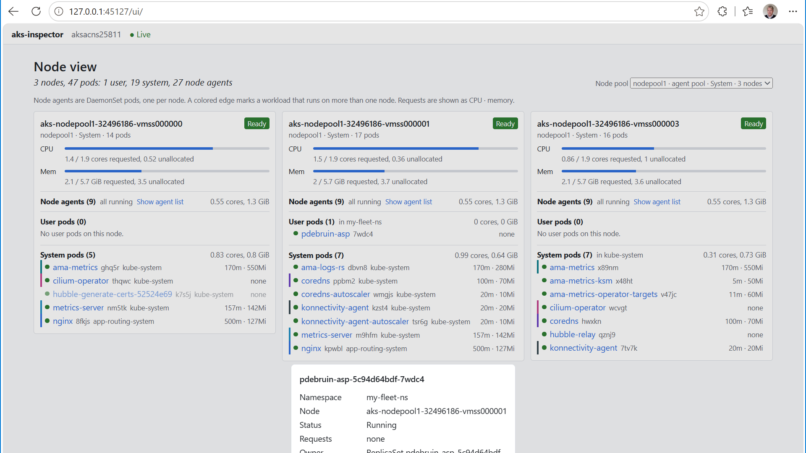

# aks-inspector

A proof of concept: a stand-alone node view for AKS that shows which pods run on which node, one node pool at a time. It runs from the command line with your local kubeconfig and opens in the browser.



## Run it

Needs Node, kubectl on the PATH, a kubeconfig with a current context, and kubelogin for Entra-enabled clusters.

```
npx aks-inspector
```

Open the URL it prints. Ctrl+C stops it. It uses the current kubeconfig context.

## What it does

The page shows one node pool at a time; NAP (Karpenter) pools and AKS agent pools are both recognized. Each node in the pool gets a column with:

- Node status: Ready, NotReady or Cordoned.
- CPU and memory requests against allocatable, calculated the way `kubectl describe node` does.
- Pods grouped as node agents (DaemonSet pods, collapsed), user pods and system pods, each with a status dot and requests. Clicking a pod opens its details.
- A colored edge on workloads that run on more than one node.

Pods that wait for a node are listed above the columns with the scheduler's reason. Lists are watched live. If a list fails, for example with HTTP 403, the page shows what failed and which RBAC permission is missing.

## How it started

aks-viz (https://github.com/pdebruin/aks-viz) is a Headlamp plugin with the same node view; it needs AKS Desktop or Headlamp to run. The MCP Inspector (https://github.com/modelcontextprotocol/inspector) showed a simpler shape: one command that starts a local web server and opens in the browser. aks-inspector takes the view logic of aks-viz and runs it that way.

Background in docs/: requirements.md describes the goal, the shape and the open questions.

## How it works

`aks-inspector` starts `kubectl proxy` on a random port on 127.0.0.1. The proxy serves the page and passes its API calls to the cluster with the credentials of your current kubeconfig context. The page lists nodes and pods once and then keeps a watch open, so changes arrive as they happen without polling.

The proxy is read only: it rejects every write method and allows only the node list, the pod list and the page itself. Secrets, logs, exec, port-forward and service proxies are rejected before they reach the cluster.

The page requests full pod objects, so everything in a pod spec, including environment variable values, reaches the browser. The Kubernetes API has no smaller response that still includes resource requests. While aks-inspector runs, any process on this machine can use the local port with your credentials.

## Dev setup

Tested on Linux (WSL) with Node 24 and npm 12.

```
cd web
npm ci
npm start
```

Tests and checks: `npm test`, `npm run build`.

RBAC needed: list and watch on nodes and pods in all namespaces.
